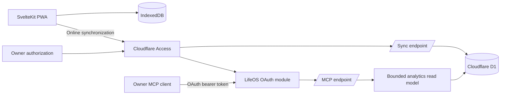

# LifeOS Training

LifeOS Training is an offline-first workout journal for planning routines, recording sessions, and reviewing training history. It is a SvelteKit progressive web application backed by browser storage, with optional authenticated synchronization through Cloudflare D1.

## Features

- Active workout tracking with persistent timers, rest intervals, set notes, and a described RPE 6–10 scale
- Reusable routines with ordered exercises, optional warmup sets, working-set defaults, coaching notes, and progression rules
- FIFO training cycles that advance only on completed workouts and infer rest after a configurable consecutive-training-day count
- Exercise history, personal records, progress charts, and calendar views
- Muscle-readiness and workload estimates derived from recorded training data
- Installable PWA behavior with an offline application shell and local workout access
- Last-write-wins synchronization for workouts, routines, and training-cycle state
- Cloudflare Access authentication for production synchronization
- Owner-scoped MCP analytics for training overview, exercise progress, routine review, and non-diagnostic training-state context
- Explicit training profiles plus a required pre-workout subjective check-in stored with every newly started workout

Training metrics are descriptive heuristics rather than medical or injury-risk assessments. Their formulas, assumptions, and evidence boundaries are documented in [`docs/training-science.md`](docs/training-science.md).

## Architecture



IndexedDB is authoritative while a workout is in progress. Changes are persisted locally before synchronization, so active sessions remain usable without a network connection. The sync endpoint applies newer records by `updatedAt` and preserves deletion tombstones to prevent stale devices from restoring removed data.

The MCP endpoint deliberately exposes typed, high-level analytics rather than SQL or arbitrary database access. Every MCP tool is read-only and returns source timestamps, confidence and evidence labels, missing-data disclosures, and non-medical caveats. The AI can discuss possible routine changes in its chat, while routine editing remains an explicit user action in LifeOS.

## Technology

- Svelte 5 and SvelteKit 2
- TypeScript
- Tailwind CSS 4
- IndexedDB
- Cloudflare Pages, Workers, D1, and Access
- Hono for the local Worker adapter
- Vitest and `svelte-check`

## Local development

### Prerequisites

- Node.js and npm
- Wrangler, installed through the project dependencies

### Start the application

```bash
npm install
npm run dev
```

The development command starts:

- the SvelteKit application on `http://localhost:5173`
- the local Hono Worker on `http://localhost:8787`
- a persistent local D1 database under `.wrangler/state`
- a same-origin `/api` proxy from Vite to the local Worker

Before startup, pending local migrations are applied and the development database is seeded idempotently.

### Available commands

| Command | Purpose |
| --- | --- |
| `npm run dev` | Start the complete local application and API stack |
| `npm run dev:web` | Start only the SvelteKit development server |
| `npm run dev:api` | Start only the local Worker |
| `npm run db:setup:local` | Apply local migrations and seed local D1 |
| `npm run db:migrate:remote` | Apply migrations to the configured remote D1 database |
| `npm test` | Run the Vitest suite |
| `npm run check` | Run Svelte and TypeScript diagnostics |
| `npm run build` | Build the Cloudflare Pages application |
| `npm run build:worker` | Validate the Worker bundle with a dry run |
| `npm run preview` | Preview the production build locally |
| `npm run deploy` | Build and deploy the Pages application |
| `npm run pwa:assets` | Regenerate PWA icon assets |

## Configuration

The committed Cloudflare configuration contains placeholder resource identifiers. Account-specific hostnames, database identifiers, Access values, and policy details must remain outside version control.

The production runtime requires the following bindings:

| Name | Type | Purpose |
| --- | --- | --- |
| `DB` | D1 binding | Stores synchronized workouts, routines, and training-cycle state |
| `OAUTH_KV` | KV binding | Stores hashed OAuth clients, grants, authorization codes, and tokens |
| `CF_ACCESS_TEAM_DOMAIN` | Environment variable | Identifies the Cloudflare Access issuer used to authenticate the owner at authorization time |
| `CF_ACCESS_AUD` | Environment variable | Identifies the Access application that protects LifeOS and the OAuth authorization page |
| `MCP_RESOURCE_URL` | Environment variable | Canonical absolute URL of the MCP endpoint |
| `MCP_ALLOWED_SUBJECT` | Environment variable | Cloudflare Access assertion subject allowed to authorize this single-owner MCP |
| `MCP_ALLOWED_HOSTS` | Environment variable | Comma-separated hostnames accepted by MCP DNS-rebinding checks |
| `MCP_ALLOWED_ORIGINS` | Environment variable | Optional comma-separated browser origins accepted by the MCP endpoint |

Local development uses `LOCAL_SYNC_TOKEN` and `MCP_LOCAL_TOKEN` from the local Worker configuration. Those credentials are not used by production builds.

### MCP analytics

The stateless Streamable HTTP endpoint is available at `/mcp`. LifeOS is its own OAuth 2.1 authorization and resource server, backed by `OAUTH_KV`; it supports PKCE, refresh tokens, Dynamic Client Registration, protected-resource discovery, and authorization-server discovery. Cloudflare Access still authenticates the owner on `/authorize`, and LifeOS verifies the signed Access assertion against `CF_ACCESS_AUD` and `MCP_ALLOWED_SUBJECT` before granting a client read-only tokens. The protected-resource metadata endpoint is `/.well-known/oauth-protected-resource/mcp`.

| Tool | Access | Result |
| --- | --- | --- |
| `get_training_overview` | Read | Session, routine, cycle, workload, muscle-dose, and freshness overview |
| `get_exercise_progress` | Read | Bounded same-exercise history and exercise-specific strength context |
| `review_routine` | Read | Routine structure reviewed against profile constraints and logged training |
| `get_training_state` | Read | Subjective check-in plus clearly separated modeled readiness and trend signals |

The server also exposes `lifeos://methodology/training-science` and `lifeos://methodology/metric-glossary`. MCP results do not include free-text workout notes and do not expose raw queries or mutation tools. Routine recommendations remain in the AI conversation; apply any change manually through the existing routine editor.

### Apple Health shortcut

Apple Health export remains device-local and user-triggered. On iPhone or iPad, LifeOS opens a saved Shortcut named `Log LifeOS Workout`; no native LifeOS app or HealthKit entitlement is required.

Create that shortcut once in Apple Shortcuts:

1. Accept text as the shortcut input and convert the JSON text to a dictionary.
2. Read `startedAt` and `durationSeconds`, convert the start value to a date, and divide the duration by 60.
3. Use **Log Workout** to add a **Traditional Strength Training** workout with the supplied start time and duration in minutes. Set Calories to `0 cal` and Distance to `0 km` so those optional fields always receive valid values.
4. Add a Text action containing `Added`, then finish with **Stop and Output** using that Text value.

LifeOS passes a versioned payload through Apple’s `shortcuts://run-shortcut` URL. It deliberately does not use an HTTPS callback because iOS opens that callback in Safari rather than the installed PWA. LifeOS does not request a return; check Apple Health after Shortcuts finishes. The launch attempt stays in IndexedDB and is not uploaded to D1. Check Apple Health before retrying because the Shortcut cannot query existing workouts through **Find Health Samples**.

## Deployment

1. Create a Cloudflare D1 database and apply the migrations in `migrations/`.
2. Create a Cloudflare KV namespace for `OAUTH_KV`.
3. Configure the `DB` and `OAUTH_KV` bindings with their deployment-specific identifiers.
4. Create a Cloudflare Access application for the deployment hostname.
5. Configure `CF_ACCESS_TEAM_DOMAIN`, `CF_ACCESS_AUD`, `MCP_RESOURCE_URL`, `MCP_ALLOWED_SUBJECT`, `MCP_ALLOWED_HOSTS`, and any browser origins allowed to call MCP.
6. Keep `/authorize` protected by the main Access application. Create a more-specific Access application with a **Bypass / Everyone** policy for `/mcp`, `/.well-known/*`, and `/oauth/*`; these public protocol routes perform their own OAuth token validation. Disable Access Managed OAuth on the main application.
7. Deploy the application:

   ```bash
   npm run deploy
   ```

8. Confirm that Access still intercepts unauthenticated UI and `/authorize` requests, authenticated synchronization succeeds, and a newly registered OAuth client can initialize MCP and list the four read-only tools.

The production sync endpoint accepts only validated Cloudflare Access assertions. It does not use a browser-managed shared secret.

## Data model

The application stores these records locally:

- workouts and their ordered exercises and sets
- reusable routines and progression settings
- the active training cycle
- an explicit training profile
- a subjective check-in embedded in each newly started workout
- custom exercise definitions
- exercise video references

Workouts, their pre-workout check-ins, routines, training-cycle records, and the training profile synchronize to D1. Ordered exercises, secondary-muscle contributions, sets, workout check-ins, and cycle slots use relational child rows with indexed timestamps, status, exercise, muscle, RPE, and completion fields for direct analytics. Device freshness is stored server-side. A revision cursor returns only records changed since the previous successful sync. Custom exercises and saved video references remain device-local. The synchronization and MCP authorization models are designed for one authenticated owner.

## Project structure

```text
src/lib/components/          Application UI
src/lib/storage.ts           IndexedDB persistence
src/lib/sync.ts              Browser synchronization client
src/lib/server/              Shared D1 synchronization logic
src/lib/server/mcp/          MCP authentication and typed tool server
src/lib/server/training-*    Shared analytics and D1 read model
src/lib/routines.ts          Routine normalization and conversion
src/lib/training-cycle.ts    Training-cycle state transitions
src/lib/training-science.ts  Training metric calculations
src/routes/api/sync/         Production sync endpoint
src/routes/mcp/              Production Streamable HTTP MCP endpoint
src/worker/                  Local Worker adapter
docs/                        Technical and research documentation
migrations/                  D1 schema migrations
public/                      PWA manifest, icons, and static assets
```

## Quality checks

Run the complete local verification set before deployment:

```bash
npm test
npm run check
npm run build
npm run build:worker
```
