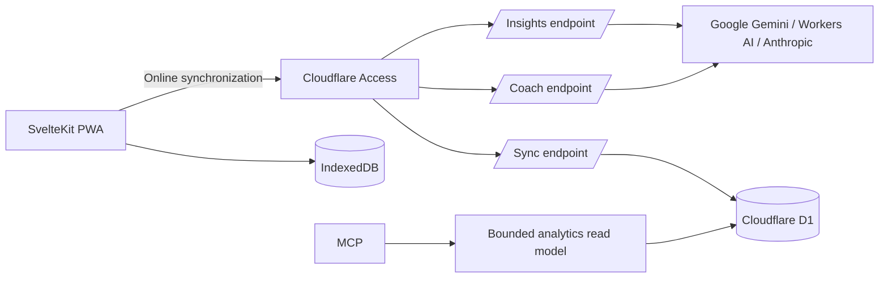

# LifeOS Training

LifeOS Training is an offline-first workout journal for planning routines, recording sessions, and reviewing training history. It is a SvelteKit progressive web application backed by browser storage, with optional authenticated synchronization through Cloudflare D1.

## Features

- Active workout tracking with persistent timers, rest intervals, set notes, and a described RPE 6–10 scale
- Reusable routines with ordered exercises, optional warmup sets, working-set defaults, coaching notes, progression rules, and centralized per-equipment load racks for non-linear dumbbell, cable, and machine stacks
- Flexible training cycles with distinct routines that move to the slot after the routine you complete, allow skipped slots, and infer rest after a configurable consecutive-training-day count
- Exercise history, personal records, progress charts, and calendar views
- Muscle-readiness and workload estimates derived from recorded training data
- Installable PWA behavior with an offline application shell and local workout access
- Last-write-wins synchronization for workouts, routines, and training-cycle state
- Cloudflare Access authentication for production synchronization
- Owner-scoped MCP analytics for training overview, exercise progress, routine review, and non-diagnostic training-state context
- Explicit training profiles plus a required pre-workout subjective check-in stored with every newly started workout
- Contextual AI actions where the data lives: report synthesis on Today, workout review in History, routine review in Routines, and progress/substitution analysis on each exercise
- A live offline-first Today report plus a dedicated detail view with a deterministic verdict, representative exercise trends, workload and readiness context, routine distribution, evidence quality, and an optional evidence-cited AI narrative

Training metrics are descriptive heuristics rather than medical or injury-risk assessments. Their formulas, assumptions, and evidence boundaries are documented in [`docs/training-science.md`](docs/training-science.md).

### Routine identity, templates, and the queue

A routine identifies a session and supplies its starting template; it is not an exercise checklist. Substitute, add, remove, or reorder exercises and change set counts or rest times freely. **Finish [routine]** saves the actual session under that routine without changing the template. Secondary **Template options** let you explicitly update the saved template or create a new one. Creating a template from an already-associated session does not reclassify that session.

The next session starts from the saved template, with exercise-history-based load and repetition suggestions. Template edits are never inferred from session changes.

Each routine can appear only once in a training cycle. Starting or cancelling a workout leaves the queue unchanged. Completing a routine in the cycle makes the position after that routine next, wrapping at the end; skipped slots are not recorded as completed workouts. For example, with Pull B queued, choosing and completing Push A makes Pull A next. This works whether you start from Today or the routine picker.

Completing a saved routine outside the cycle retains its routine association without moving the queue. A workout with no routine association is a one-off and also leaves the queue unchanged.

## Architecture



IndexedDB is authoritative while a workout is in progress. Changes are persisted locally before synchronization, so active sessions remain usable without a network connection. The sync endpoint applies newer records by `updatedAt` and preserves deletion tombstones to prevent stale devices from restoring removed data.

The MCP endpoint deliberately exposes typed, high-level analytics rather than SQL or arbitrary database access. Every MCP tool is read-only and returns source timestamps, confidence and evidence labels, missing-data disclosures, and non-medical caveats. The AI can discuss possible routine changes in its chat, while routine editing remains an explicit user action in LifeOS.

The Today coach and contextual AI actions send bounded, locally derived context to authenticated endpoints. LifeOS calculates readiness, load, progression, candidate substitutions, and performance signals deterministically; the selected model must turn those facts into decision-oriented comparisons, tradeoffs, and measurable next actions rather than recapping visible records. Responses are schema-validated and carry explicit citations. Workout notes, exercise notes, set notes, routine notes, and check-in notes are excluded. Generated coach briefs, contextual AI results, and provider preferences are stored in local IndexedDB. Each result is restored in its original Today, History, Routine, or Exercise surface until the user explicitly refreshes it; these generated results are device-local and are not synchronized to D1.

## Technology

- Svelte 5 and SvelteKit 2
- TypeScript
- Tailwind CSS 4
- IndexedDB
- Cloudflare Pages, Workers, D1, and Access
- Hono for the local Worker adapter
- Vitest and `svelte-check`

## Local development

### Prerequisites

- Node.js 22.13+ (or a supported newer release) and npm
- Wrangler, installed through the project dependencies

### Start the application

```bash
npm install
npm run dev
```

The development command starts:

- the SvelteKit application on `http://localhost:5173`
- the local Hono Worker on `http://localhost:8787`
- a persistent local D1 database under `.wrangler/state`
- a same-origin `/api` proxy from Vite to the local Worker

Before startup, pending local migrations are applied and the development database is seeded idempotently.

### Copy production data into local testing

```bash
npx wrangler login # only if this machine is not already authenticated
npm run db:sync:local
```

This is a one-way copy from the production D1 database configured in `wrangler.toml` into the local database configured in `wrangler.worker.toml`, persisted under `.wrangler/state`. It never writes to production. The command validates the production export, backs up local D1, replaces local tables in one atomic batch, verifies row counts and foreign keys, and applies any newer local migrations without seeding demo data.

**Local D1 data is replaced, not merged.** Avoid editing the local app while the command runs. Once it succeeds, start `npm run dev` if needed and reload `http://localhost:5173`. Development startup already pulls a full snapshot from local D1 into IndexedDB without uploading stale browser records first.

Timestamped `production.sql`, `local-before-sync.sql`, and `import.sql` files are retained in `.wrangler/backups/production-sync-*`. These contain private data; the command creates owner-only files/directories, and `.wrangler` is gitignored. A failed local import rolls back that batch; completed exports remain available.

Only data synchronized to production D1 can be copied. Browser-only AI credentials, generated AI reports, exercise videos, and unsynchronized edits are not included.

### Available commands

| Command | Purpose |
| --- | --- |
| `npm run dev` | Start the complete local application and API stack |
| `npm run dev:web` | Start only the SvelteKit development server |
| `npm run dev:api` | Start only the local Worker |
| `npm run db:setup:local` | Apply local migrations and seed local D1 |
| `npm run db:sync:local` | Back up local D1 and replace it with a validated production snapshot |
| `npm run db:migrate:remote` | Apply migrations to the configured remote D1 database |
| `npm test` | Run the Vitest suite |
| `npm run check` | Run Svelte and TypeScript diagnostics |
| `npm run build` | Build the Cloudflare Pages application |
| `npm run build:worker` | Validate the Worker bundle with a dry run |
| `npm run preview` | Preview the production build locally |
| `npm run deploy` | Build and deploy the Pages application |
| `npm run pwa:assets` | Regenerate PWA icon assets |

## Configuration

The committed Cloudflare configuration contains placeholder resource identifiers. Account-specific hostnames, database identifiers, Access values, and policy details must remain outside version control.

The production runtime requires the following bindings:

| Name | Type | Purpose |
| --- | --- | --- |
| `DB` | D1 binding | Stores synchronized workouts, routines, and training-cycle state |
| `MCP_SHARED_KEY` | Worker secret | Authenticates the single owner through the MCP URL |
| `MCP_RESOURCE_URL` | Environment variable | Canonical absolute URL of the MCP endpoint |
| `MCP_ALLOWED_HOSTS` | Environment variable | Comma-separated hostnames accepted by MCP DNS-rebinding checks |
| `MCP_ALLOWED_ORIGINS` | Environment variable | Optional comma-separated browser origins accepted by the MCP endpoint |
| `AI` | Workers AI binding | Optional Cloudflare-hosted model provider for Today coach briefs |
| `AI_DEFAULT_PROVIDER` | Environment variable | Optional default: `gemini`, `workers-ai`, or `anthropic` |
| `CLOUDFLARE_AI_MODEL` | Environment variable | Workers AI model identifier; defaults to the committed Llama model |
| `GEMINI_API_KEY` | Secret | Optional server-side Gemini credential used when no browser-saved key is selected |
| `GEMINI_MODEL` | Environment variable | Default Gemini model identifier shown in settings; defaults to `gemini-3.8-flash` |
| `GEMINI_BASE_URL` | Environment variable | Optional Gemini API base URL, default `https://generativelanguage.googleapis.com/v1beta` |
| `ANTHROPIC_API_KEY` | Secret | Optional server-side Anthropic credential used when no browser-saved key is selected |
| `ANTHROPIC_MODEL` | Environment variable | Anthropic model identifier |
| `ANTHROPIC_BASE_URL` | Environment variable | Optional Anthropic API base URL, default `https://api.anthropic.com/v1` |

Local development uses `LOCAL_SYNC_TOKEN` and a local `MCP_SHARED_KEY` from the local Worker configuration. Those credentials are not used by production builds.

### AI providers and insights

The Data & AI screen always offers Gemini, Cloudflare Workers AI, and Anthropic. Select one provider, enter its model identifier, and optionally save its key in the browser. A browser-saved key takes precedence over the matching server credential.

- **Google Gemini (primary cloud provider):** enter a Gemini API key in Data & AI or set `GEMINI_API_KEY` on the server. The default model is `gemini-3.8-flash`.
- **Cloudflare Workers AI:** use the server `AI` binding, or enter a Workers AI API token and Cloudflare account ID in Data & AI. The default model is `@cf/meta/llama-3.3-70b-instruct-fp8-fast`.
- **Anthropic:** enter an Anthropic API key in Data & AI or set `ANTHROPIC_API_KEY` on the server. `ANTHROPIC_MODEL` supplies the initial model default.

The provider, provider-specific model identifiers, browser-entered API keys, and Cloudflare account ID are persisted only in this browser's IndexedDB. They are excluded from LifeOS synchronization. Browser-entered credentials travel only to the authenticated, same-origin `/api/coach` or `/api/insights` endpoint for the requested generation; the endpoints forward them to the selected provider and never return them in catalogs or generated results. Leave the key blank to use server configuration.

AI actions live beside their source data:

- **Today → daily signals:** continuously render the deterministic progress verdict, target readiness, load ratio, and top exercise trends, with a direct path to the full report.
- **History → saved workout → Review this workout:** compare a completed session with prior same-exercise history.
- **Routines → Review routine with AI:** review exercise selection and set distribution against the saved profile and logged trends.
- **Exercise → AI → Progress:** explain an exercise trend from recent comparable exposures and confidence coverage.
- **Exercise → AI → Swap:** rank eligible substitutions after deterministic equipment and exclusion filtering.
- **Progress report → Generate narrative:** synthesize the deterministic report into a verdict, supported findings, and prioritized next actions. The report metrics remain available offline and are never generated by the model.

Every generated finding must cite an evidence record supplied by LifeOS. Responses that cite unknown evidence or violate the fixed schema are rejected. Pain and illness never produce medical clearance; deterministic safety rules block training-change recommendations while those check-in signals are current.

Gemini `generateContent` requests use the documented REST `generationConfig.responseFormat.text.schema` shape. The constrained-decoding schema remains intentionally small; LifeOS validates evidence IDs and text-length limits after generation, avoiding provider-side `INVALID_ARGUMENT` failures without weakening citation or response validation.

For local development, you can configure credentials in Data & AI or put server fallback credentials and model names in the ignored `.dev.vars` file. The local Worker has no Workers AI binding by default, avoiding remote AI usage charges during ordinary development.

### MCP analytics

The stateless Streamable HTTP endpoint is available at `/mcp`. Every request must include the configured shared key as the single `key` query parameter, for example `https://life.w9m.app/mcp?key=<shared-key>`. The key is stored as a Cloudflare Worker secret and is never committed. The MCP route remains separate from the Cloudflare Access-protected application and synchronization routes.

| Tool | Access | Result |
| --- | --- | --- |
| `get_training_overview` | Read | Session, routine, cycle, workload, muscle-dose, and freshness overview |
| `get_exercise_progress` | Read | Bounded same-exercise history and exercise-specific strength context |
| `review_routine` | Read | Routine structure reviewed against profile constraints and logged training |
| `get_training_state` | Read | Subjective check-in plus clearly separated modeled readiness and trend signals |

The server also exposes `lifeos://methodology/training-science` and `lifeos://methodology/metric-glossary`. MCP results do not include free-text workout notes and do not expose raw queries or mutation tools. Routine recommendations remain in the AI conversation; apply any change manually through the existing routine editor.

### Apple Health shortcut

Apple Health export remains device-local and user-triggered. On iPhone or iPad, LifeOS opens a saved Shortcut named `Log LifeOS Workout`; no native LifeOS app or HealthKit entitlement is required.

Create that shortcut once in Apple Shortcuts:

1. Accept text as the shortcut input and convert the JSON text to a dictionary.
2. Read `startedAt` and `durationSeconds`, convert the start value to a date, and divide the duration by 60.
3. Use **Log Workout** to add a **Traditional Strength Training** workout with the supplied start time and duration in minutes. Set Calories to `0 cal` and Distance to `0 km` so those optional fields always receive valid values.
4. Add a Text action containing `Added`, then finish with **Stop and Output** using that Text value.

LifeOS passes a versioned payload through Apple’s `shortcuts://run-shortcut` URL. It deliberately does not use an HTTPS callback because iOS opens that callback in Safari rather than the installed PWA. LifeOS does not request a return; check Apple Health after Shortcuts finishes. The launch attempt stays in IndexedDB and is not uploaded to D1. Check Apple Health before retrying because the Shortcut cannot query existing workouts through **Find Health Samples**.

## Deployment

1. Create a Cloudflare D1 database and apply the migrations in `migrations/`.
2. Configure the `DB` binding with its deployment-specific identifier.
3. Create a Cloudflare Access application for the LifeOS application and synchronization endpoint.
4. Optionally store `GEMINI_API_KEY` as a Pages secret for a deployment-wide fallback, and retain or configure the `AI` Workers AI binding for Cloudflare-hosted inference. Users can instead provide browser-local keys in Data & AI.
5. Configure `MCP_RESOURCE_URL`, `MCP_ALLOWED_HOSTS`, and any browser origins allowed to call MCP.
6. Store the production MCP key as a Worker secret:

   ```bash
   npx wrangler secret put MCP_SHARED_KEY --config wrangler.mcp.toml
   ```

7. Keep `/mcp*` outside the main Access policy so MCP clients can reach the Worker’s shared-key gate. Keep `/api/coach` inside the application’s Access policy.
8. Deploy the application:

   ```bash
   npm run deploy
   ```

9. Confirm that the Data & AI screen lists the configured providers, generate a Today coach brief, and verify that an MCP request without the shared key is rejected.

The production sync endpoint still accepts only validated Cloudflare Access assertions. The MCP shared key authenticates only the separate read-only analytics endpoint and must be treated as a password because it is part of the configured URL.

## Data model

The application stores these records locally:

- workouts and their ordered exercises and sets
- reusable routines and progression settings
- centralized per-equipment load-rack settings
- the active training cycle
- an explicit training profile
- a subjective check-in embedded in each newly started workout
- custom exercise definitions
- exercise video references
- local AI provider preference and the latest generated coach brief

Workouts, their pre-workout check-ins, routines, training-cycle records, the training profile, and equipment rack settings synchronize to D1. Each new workout snapshots the applicable equipment rack so historical targets remain stable when settings change. Ordered exercises, secondary-muscle contributions, sets, workout check-ins, and cycle slots use relational child rows with indexed timestamps, status, exercise, muscle, RPE, and completion fields for direct analytics. Device freshness is stored server-side. A revision cursor returns only records changed since the previous successful sync. Custom exercises and saved video references remain device-local. The synchronization and MCP authorization models are designed for one authenticated owner.

## Project structure

```text
src/lib/components/          Application UI
src/lib/storage.ts           IndexedDB persistence
src/lib/sync.ts              Browser synchronization client
src/lib/server/              Shared D1 synchronization logic
src/lib/ai-coach.ts          Bounded coach context and browser client
src/lib/server/ai-coach.ts   Authenticated model-provider adapters and output validation
src/lib/server/mcp/          MCP authentication and typed tool server
src/lib/server/training-*    D1 training read-model adapters
src/lib/routines.ts          Routine normalization and conversion
src/lib/training-cycle.ts    Training-cycle state transitions
src/lib/training-science.ts  Training metric calculations
src/lib/training-analysis.ts Shared evidence-labelled analytics used by the app and MCP
src/lib/training-progress-report.ts Deterministic report composition, verdicts, coverage, and cache fingerprinting
src/routes/api/sync/         Production sync endpoint
src/routes/mcp/              Production Streamable HTTP MCP endpoint
src/worker/                  Local Worker adapter
docs/                        Technical and research documentation
migrations/                  D1 schema migrations
public/                      PWA manifest, icons, and static assets
```

## Quality checks

Run the complete local verification set before deployment:

```bash
npm test
npm run check
npm run build
npm run build:worker
```
