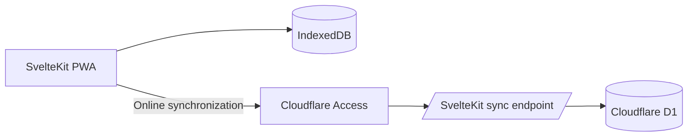

# LifeOS Training

LifeOS Training is an offline-first workout journal for planning routines, recording sessions, and reviewing training history. It is a SvelteKit progressive web application backed by browser storage, with optional authenticated synchronization through Cloudflare D1.

## Features

- Active workout tracking with persistent timers, rest intervals, set notes, failure state, and RPE
- Reusable routines with ordered exercises, default sets, coaching notes, and progression rules
- Completion-driven training cycles with routine and recovery slots
- Exercise history, personal records, progress charts, and calendar views
- Muscle-readiness and workload estimates derived from recorded training data
- Installable PWA behavior with an offline application shell and local workout access
- Last-write-wins synchronization for workouts, routines, and training-cycle state
- Cloudflare Access authentication for production synchronization

Training metrics are descriptive heuristics rather than medical or injury-risk assessments. Their formulas, assumptions, and evidence boundaries are documented in [`docs/training-science.md`](docs/training-science.md).

## Architecture



IndexedDB is authoritative while a workout is in progress. Changes are persisted locally before synchronization, so active sessions remain usable without a network connection. The sync endpoint applies newer records by `updatedAt` and preserves deletion tombstones to prevent stale devices from restoring removed data.

## Technology

- Svelte 5 and SvelteKit 2
- TypeScript
- Tailwind CSS 4
- IndexedDB
- Cloudflare Pages, Workers, D1, and Access
- Hono for the local Worker adapter
- Vitest and `svelte-check`

## Local development

### Prerequisites

- Node.js and npm
- Wrangler, installed through the project dependencies

### Start the application

```bash
npm install
npm run dev
```

The development command starts:

- the SvelteKit application on `http://localhost:5173`
- the local Hono Worker on `http://localhost:8787`
- a persistent local D1 database under `.wrangler/state`
- a same-origin `/api` proxy from Vite to the local Worker

Before startup, pending local migrations are applied and the development database is seeded idempotently.

### Available commands

| Command | Purpose |
| --- | --- |
| `npm run dev` | Start the complete local application and API stack |
| `npm run dev:web` | Start only the SvelteKit development server |
| `npm run dev:api` | Start only the local Worker |
| `npm run db:setup:local` | Apply local migrations and seed local D1 |
| `npm run db:migrate:remote` | Apply migrations to the configured remote D1 database |
| `npm test` | Run the Vitest suite |
| `npm run check` | Run Svelte and TypeScript diagnostics |
| `npm run build` | Build the Cloudflare Pages application |
| `npm run build:worker` | Validate the Worker bundle with a dry run |
| `npm run preview` | Preview the production build locally |
| `npm run deploy` | Build and deploy the Pages application |
| `npm run pwa:assets` | Regenerate PWA icon assets |

## Configuration

The committed Cloudflare configuration contains placeholder resource identifiers. Account-specific hostnames, database identifiers, Access values, and policy details must remain outside version control.

The production runtime requires the following bindings:

| Name | Type | Purpose |
| --- | --- | --- |
| `DB` | D1 binding | Stores synchronized workouts, routines, and training-cycle state |
| `CF_ACCESS_TEAM_DOMAIN` | Environment variable | Identifies the Cloudflare Access issuer |
| `CF_ACCESS_AUD` | Environment variable | Identifies the protected Access application |

Local development uses `LOCAL_SYNC_TOKEN` from the local Worker configuration. That credential is not used by production builds.

### Apple Health shortcut

Apple Health export remains device-local and user-triggered. On iPhone or iPad, LifeOS opens a saved Shortcut named `Log LifeOS Workout`; no native LifeOS app or HealthKit entitlement is required.

Create that shortcut once in Apple Shortcuts:

1. Accept text as the shortcut input and convert the JSON text to a dictionary.
2. Read `startedAt` and `durationSeconds`, convert the start value to a date, and divide the duration by 60.
3. Use **Log Workout** to add a **Traditional Strength Training** workout with the supplied start time and duration in minutes. Set Calories to `0 cal` and Distance to `0 km` so those optional fields always receive valid values.
4. Add a Text action containing `Added`, then finish with **Stop and Output** using that Text value.

LifeOS passes a versioned payload through Apple’s `shortcuts://run-shortcut` URL. It deliberately does not use an HTTPS callback because iOS opens that callback in Safari rather than the installed PWA. LifeOS does not request a return; check Apple Health after Shortcuts finishes. The launch attempt stays in IndexedDB and is not uploaded to D1. Check Apple Health before retrying because the Shortcut cannot query existing workouts through **Find Health Samples**.

## Deployment

1. Create a Cloudflare D1 database.
2. Apply the migrations in `migrations/`.
3. Configure the `DB` binding with the deployment-specific database identifier.
4. Create a Cloudflare Access application for the deployment hostname.
5. Configure `CF_ACCESS_TEAM_DOMAIN` and `CF_ACCESS_AUD` in the Pages environment.
6. Deploy the application:

   ```bash
   npm run deploy
   ```

7. Confirm that unauthenticated requests are intercepted by Access and that authenticated synchronization succeeds.

The production sync endpoint accepts only validated Cloudflare Access assertions. It does not use a browser-managed shared secret.

## Data model

The application stores these records locally:

- workouts and their ordered exercises and sets
- reusable routines and progression settings
- the active training cycle
- custom exercise definitions
- exercise video references

Workouts, routines, and training-cycle records synchronize to normalized D1 tables. Ordered exercises, secondary-muscle contributions, sets, and cycle slots use relational child rows with indexed timestamps, status, exercise, muscle, RPE, and completion fields for direct analytics. A revision cursor returns only records changed since the previous successful sync. Custom exercises and saved video references remain device-local. The synchronization model is designed for one authenticated owner; a multi-user deployment would additionally require identity-scoped records.

## Project structure

```text
src/lib/components/          Application UI
src/lib/storage.ts           IndexedDB persistence
src/lib/sync.ts              Browser synchronization client
src/lib/server/              Shared D1 synchronization logic
src/lib/routines.ts          Routine normalization and conversion
src/lib/training-cycle.ts    Training-cycle state transitions
src/lib/training-science.ts  Training metric calculations
src/routes/api/sync/         Production sync endpoint
src/worker/                  Local Worker adapter
docs/                        Technical and research documentation
migrations/                  D1 schema migrations
public/                      PWA manifest, icons, and static assets
```

## Quality checks

Run the complete local verification set before deployment:

```bash
npm test
npm run check
npm run build
npm run build:worker
```
